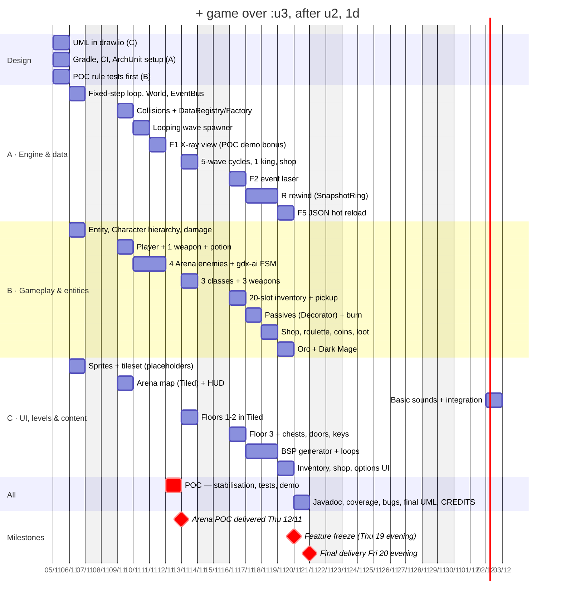

# Calendar

The 12 Nov POC was cancelled on 4 Nov. The only delivery is the full GDD plus the full playable game on 22 Nov at 23:50. Internal milestone (confirmed by Ange, 4 Nov): the GDD is finished by 5 Nov. The team fills in the rest of this tab once the GDD is done.

## Milestones

| Milestone | Date | Deliverable | Owner | Status |
| --- | --- | --- | --- | --- |
| Full GDD | Nov 5, 2026 | GDD |  |  |
| POC | Nov 12, 2026 | Cancelled on 4 Nov, no intermediate delivery. Its scope stays as the first slice to build and the Arena game mode (GDD 1.1.1). |  | Not started |
| Full GDD + full game | Nov 22, 2026, 23:50 | Full playable game, all GDD sections filled, UML, unit tests + CI, coverage, Javadoc | All | In progress |
| Review presentation | To set | Present game and documents, playable demo | All | Not started |
|  |  |  |  |  |

## Week by week (to fill after the GDD)

| projet programation orienté objetWeek | Ange | Loïc | Romain |
| --- | --- | --- | --- |
| 3–9 Nov |  |  |  |
| 10–16 Nov&#32; |  |  |  |
| 17–22 Nov (full GDD + game on 22 Nov, 23:50) |  |  |  |

## Proposed schedule (Loïc's Claude, 5 Nov) \[OPEN\]

Loïc's day-by-day plan, for the team to validate. Two points conflict with earlier decisions, so the Milestones table above is left unchanged until the team decides: (1) this plan delivers an Arena POC on Thu 12 Nov, but the 12 Nov POC was cancelled on 4 Nov; (2) the "Cut scope" list reverses decisions of 4 Nov (all four engine features ship, TAB editor included; three kings; Alchemist and Necromancer in the roster; key remap in Options). Internal final delivery: Fri 20 Nov evening; the official deadline stays 22 Nov at 23:50. No weekend work: 12 working days.

### Work streams

- **A · Engine & data**: game loop, collisions, JSON data, debug features (F1, F2, R, F5)
- **B · Gameplay & entities**: characters, enemies, weapons, items, shop
- **C · UI, levels & content**: screens, HUD, Tiled maps, generator, sounds

### Tasks

| Day | Stream | Task | Status |
| --- | --- | --- | --- |
| Thu 5 Nov | A | Gradle, CI and ArchUnit setup | Done |
| Thu 5 Nov | B | POC rule tests, written before the code | Done |
| Thu 5 Nov | C | UML in draw.io | Done |
| Fri 6 Nov | A | Fixed-step loop, World, EventBus | Done |
| Fri 6 Nov | B | Entity / Character hierarchy, damage formula | Done |
| Fri 6 Nov | C | Sprites + tileset (placeholders) | Done |
| Mon 9 Nov | B | Character extends Entity: body box in the constructor, `onUpdate()` replaces `update()`, 3 new tests in CharacterTest (Romain, merged on main) | Done |
| Mon 9 Nov | A | AABB collisions + JSON DataRegistry / EntityFactory | Done (Loïc, 10–12 Nov). Collisions: `World.isFree(box, mover)` for blocking and `resolveContacts()`, which calls `onContact()` on both entities of every overlapping pair after the updates; 8 new tests, 20 in WorldTest (PR #31). JSON data: `DataRegistry` reads one data file per category and indexes it by id, with `reload()` for F5; `ItemFactory` builds a `Potion` from `data/items.json`; `EnemyFactory` gives an `EnemySpec` (id, sprite, `BaseStats`, body size) from `data/enemies.json` for the rat and the zombie; 21 tests (PR #38, Javadoc PR #39). The enemy classes are done (Tue 10 → Wed 11 Nov B row). Since 19 Nov (Romain, `fix/character-spawn`) `CharacterFactory` builds the players and the enemies from `data/characters.json`, which replaces `enemies.json`; the floor multiplier and summoned enemies are still to do |
| Mon 9 Nov | B | Player + 1 weapon + potion | In progress. Merged on main: Item, Rarity, Consumable, Potion, Equipment and Weapon (Attack strategy, `hit()`); Character reads its stats from `Stat` / `BaseStats` and gets `heal()`; damage formula gets a resistance bonus and buff (Romain); Player and Knight walk from a `PlayerInput` (Ange). In review on `feature/first-weapon` (Romain): `Obb` (rotated rectangle, separating axis theorem), `Hitbox` (lifetime, hits each target once), `Faction` (an attack never hurts its own side), `HitResult`, `MeleeWeapon` and `Sword` (built from `items.json`), `Swing` (the blade sweeps the arc and publishes `DamageDealt` / `EntityDied`), attack cooldown in `Character` (after the swing, weapon × character attack speed), `ItemFactory` as a map. Every weapon attacks through `Attack.attack(owner, aim, world)` (`fix/correct-weapon`). Done on `feature/attack-character` (Romain, 18 Nov): the Knight holds its sword through its inventory and attacks with the left mouse button held, towards the mouse; attack animation; the blade shows in red in the F1 X-ray view |
| Mon 9 Nov | C | Arena map (Tiled) + HUD | Done (Ange, 10–12 Nov). Arena map: `assets/arena_mapV1.tmx`, 30 × 20 tiles on the arena tileset (PR #26, #27). HUD: Scene2D `Hud` (HP bar, coin counter, 3 quick slots, minimap frame) reading a `HudState` model, UI skin and a pixel font made with Hiero (PR #29, #33) |
| Mon 9 Nov | B | Entity implements Updatable + Collidable: `blocks()`, `onContact()`, `position()`, `moveTo()`, 12 tests in EntityTest (Loïc, PR #21) | Done |
| Tue 10 Nov | A | Looping enemy waves | To do |
| Tue 10 → Wed 11 Nov | B | 4 Arena enemies + gdx-ai FSM | In progress (Loïc, 13–16 Nov, `feature/enemy`): the enemy hierarchy of the UML, tests written first. `Enemy` (abstract): gdx-ai state machine, target, `canSee()`, `alert()`, enemy faction, summoned flag. `EnemyState`: the 8 states of the UML, empty until the AI. `MeleeEnemy`: reach and contact attack (`Obb` around the body, damage formula, publishes `DamageDealt`). `Rat` and `Zombie`, with no code of their own. `EnemyBuilder` test data builder; 19 tests (EnemyTest, MeleeEnemyTest). Done (Romain, 19 Nov, `fix/character-spawn`): `GameScreen` spawns the knight and the rats through `CharacterFactory` (`EnemyFactory` + `PlayerFactory`), reading every spawn tile in one pass. To do: state behaviour (chase, attack), the floor multiplier and summoned enemies in `EnemyFactory`, Orc and the other Arena enemies, loot |
| Tue 10 Nov | C | Title screen + game over | Done (Ange, PR #33 merged 12 Nov; game over on `feature/game-over`, 15 Nov): title screen (Play, Quit), mode select (Arena, Endless) and character select (Knight playable, Mage and Archer locked) done in `MenuScreen`, driven by the `MenuFlowState` state machine and its tests. Game over: when the player's HP reaches 0, `GameScreen` opens the game over page (score = waves defeated, Rerun keeps the mode and goes back to the character select, Main menu goes to the title); new `GAME_OVER` step in `MenuFlowState`, 5 new tests |
| Wed 11 Nov | A | F1 X-ray view (demo bonus) | Done (Ange, 15 Nov, `feature/view-switcher`): F1 loops through 3 views, sprites → X-ray (body boxes, hurtboxes, velocity vector) → high contrast. `ViewSwitcher` (`DebugFeature`) and `ViewMode` in core, 11 tests; Strategy `Renderer` with `SpriteRenderer`, `XRayRenderer` and `HighContrastRenderer` in desktop. Hitboxes get their colour once attacks exist in the world; 20 Nov (Romain): the player's hurtbox turns blue while it is invincible, enemies' hurtboxes are magenta |
| Wed 11 Nov | C | Basic sounds + integration | Done (Romain, 21 Nov, `feature/sound-design`): `GameAudio`, made once by `GameApplication` and shared by every screen, plays 10 effects and the music loop (quieter on menus, never restarted). `SoundEvents` turns `AttackStarted`, `DamageDealt`, `EntityDied` and the new `ItemPickedUp` into sounds; `SoundOverlapGuard` stops one source from playing the same sound twice at once (5 tests). Player footsteps; menu hover and click sounds. Also `RangedWeapon`, `Bow` and `Staff`, ready for Ange's ranged weapons (11 tests); 22 Nov (Romain, `feature/music`): every sound effect plays at 0.3 of its volume (the bow louder at 0.45, the staff 0.21, the menu sounds 0.24) and the music at 0.5 on menus and 1 in game; the game has its own musics by Renaud Beaud / JB (main, boss, victory, each an intro then a loop), crossfaded over 1.5 s by `MusicPlayer` / `MusicMix`; the menus keep the ambient loop |
| Thu 12 Nov | C | Menu → game wiring: picking a hero opens `GameScreen`, which loads the arena map and runs `World`, `FixedTimestep` and (in Arena mode) `ArenaCycle` at 60 ticks per second; Escape goes back to the title; `MenuFlowStateTest` moved to `desktop/src/test/java` so it runs (Ange, PR #34) | Done |
| Thu 12 Nov | All | **Arena POC: stabilisation, green tests, demo, delivery** | To do |
| Fri 13 Nov | A | 5-wave cycles, 1 king, shop | In progress: `ArenaCycle` done (WAVE / BREAK / SHOP phases, boss every 5th wave, score = waves defeated; Ange, PR #15, 6 Nov) and ticked by the game screen since PR #34. King and shop to do |
| Fri 13 Nov | B | 3 classes + 3 weapons | In progress: ranged weapons in game (Romain, 22 Nov, `feature/range-weapon`): the short bow shoots arrows and the fire staff casts fireballs that burn, both built from `items.json`; each projectile's picture comes from its weapon's entry (`projectileSpriteId`), is drawn turned along its flight, and its hitbox shows in red in F1 X-ray; projectiles hit walls with their turned hitbox. Mage and Archer classes to do; 22 Nov (Romain, `fix/balance`): 8 more bows and 7 more staves, one sprite each, told apart by damage, cooldown, range and projectile speed |
| Fri 13 Nov | C | Floors 1–2 in Tiled | To do |
| Mon 16 Nov | A | F2 event laser | Done early (Ange, 15 Nov, `feature/event-laser`): `EventLaser` (`DebugFeature`, listens to every event) turns each event into a half-second line from its emitter to its receiver, drawn over any F1 view and toggled with F2. `GameEvent.receiver()` added (the target of `DamageDealt`, empty for a death); 12 new tests. Lines show in game once combat and enemies publish events |
| Mon 16 Nov | B | 20-slot inventory + pickup | Done (Romain, 17–20 Nov, `feature/inventory`): `Inventory` holds the weapon, the armor (`Armor` / `LeatherArmor`, the knight starts with `leather_armor`), 3 consumable slots and 18 passive slots; passive items apply in slot order and two slots can be swapped (Switch). `Player.pickUp(item)` takes any item and rebuilds; the old weapon or armor, or an item that does not fit, falls back on the ground. Items on the ground: `ItemDrop`, put there only by `ItemDropper` (`drop` / `spawn`, and the `ItemDropped` event); E picks up the nearest one within 32 px. The R rewind also saves the inventory |
| Mon 16 Nov | C | Floor 3 + chests, doors, keys | To do |
| Sun 15 Nov | All | Janitor pass (Ange, `fix/janitor`): test fakes written before the real classes replaced by `Wall` and `Potion`; every null and argument check gets a full-sentence message with the bad value; `Wall` made `final`; `resume.md` no longer tracked | Done |
| Tue 17 → Wed 18 Nov | A | R rewind (SnapshotRing) | To do (Ange, next) |
| Tue 17 Nov | B | Passive items (Decorator) + burn | Done (Ange, 17 Nov, PR #61): `PassiveItem` (rarity `PASSIVE`, refused by equipment) is a `BuildModifier` with two hooks, `decorateStats` and `decorateAttack`. `FireRing` wraps the holder's attack in a `FireTouch` (`AttackDecorator`), so every hit that lands burns the target. Status effects: `StatusEffect` (Template Method) and `Burn`, built from a `BurnSpec` (damage, interval, duration in ticks); characters tick them on each update. `Character.takeStatusDamage` ignores i-frames and publishes `DamageDealt` / `EntityDied` credited to the source. `ItemSpecReader` / `EnemySpecReader` turn the JSON entries into typed specs, and `fire_ring` is in `items.json`. Javadoc and UML updated; 591 tests. To do: the passive slots in the inventory. The ring applies to the player's hits since 18 Nov (`feature/attack-character`) |
| Tue 17 → Wed 18 Nov | C | BSP generator + loops | To do |
| Wed 18 Nov | B | Shop, roulette, coins, loot | In progress: loot done (Romain, 22 Nov, `fix/balance`): a killed enemy drops an item 20 % of the time, a rarity picked by its share (potions 35 %, rings 25 %, common 20 %, rare 13 %, epic 5 %, legendary 2 %) then one item of it; shop stock, roulette and coins to do |
| Thu 19 Nov | A | F5 JSON hot reload | To do |
| Thu 19 Nov | B | Orc + Dark Mage | To do |
| Thu 19 Nov | C | Inventory, shop and options UI | Inventory done (Romain, 20 Nov, `feature/inventory`): the HUD hotbar shows the consumables, 1/2/3 select one and A (Q in QWERTY) uses it; I opens the inventory page and pauses the game: equipment, stats and consumables on the left, the 18 passive slots on the right, a click shows an item's effects with Drop and Switch. Shop and options UI to do; HUD info (Romain, 22 Nov, `fix/display-and-other`): the wave (or floor in Endless) at the bottom left, the Arena countdown or "Shop open" at the top, a BOSS title and life bar during the boss fight, the keys on the hotbar, "E: pick up" above the item in range, and an H panel with every control (plus an "H: controls" hint for the first 6 s) |
| Fri 20 Nov | B | Dash + dodge roll (not in the plan) | Done (Romain, 20 Nov, `feature/dash`): Shift dashes (0.2 s at 3x SPEED, can be hit), Space dodge rolls (0.4 s at 1.5x SPEED, invincible); once per press, in the walking direction, each with its own cooldown after it (0.5 s / 0.8 s); base values in the `Evade` enum; the rewind restores them; walking and dashing now stop flush against walls |
| Sun 22 Nov | B | Hit preview (not in the plan) | Done (Romain, 22 Nov, `fix/hitbox-anim`): during a melee swing, the area the blade has swept shows on the floor (white, translucent, growing with the swing); a bow or a staff shows a dashed line as long as its range towards the mouse, faint all the time and stronger while the attack button is held; only in the normal view (F1 X-ray already shows the real hitboxes) |
| Fri 20 Nov | All | **Javadoc, 70 % coverage, bugs, final UML, CREDITS, rehearsal, delivery** | In progress (Romain, 22 Nov, `fix/janitor-uml`): javadoc prints no warning (93 fixed); core coverage 99.7 % of lines; UML generated from the code (13 diagrams + the 4 drafts remade); `this-escape` on Player fixed. Rehearsal and delivery (22 Nov 23:50) to do |

### Rotation (Loïc's Claude, 6 Nov) \[OPEN\]

Proposal for the team to confirm: everyone does a bit of everything, so each person changes stream every day. Over the 9 days with three tasks, each person gets every stream exactly 3 times. The tasks are the ones in the table above.

| Day | Ange | Loïc | Romain |
| --- | --- | --- | --- |
| Fri 6 Nov | A · Fixed-step loop, World, EventBus | B · Entity / Character hierarchy, damage formula | C · Sprites + tileset (placeholders) |
| Mon 9 Nov | B · Player + 1 weapon + potion | C · Arena map (Tiled) + HUD (not started; did B · Updatable + Collidable on Entity instead, PR #21) | A · AABB collisions + JSON DataRegistry / EntityFactory |
| Tue 10 Nov | C · Title screen + game over | A · Looping enemy waves | B · 4 Arena enemies + gdx-ai FSM (day 1 of 2) |
| Wed 11 Nov | A · F1 X-ray view | C · Basic sounds + integration | B · 4 Arena enemies + gdx-ai FSM (day 2 of 2) |
| Thu 12 Nov | All | All | All |
| Fri 13 Nov | C · Floors 1–2 in Tiled | B · 3 classes + 3 weapons | A · 5-wave cycles, 1 king, shop |
| Mon 16 Nov | A · F2 event laser | C · Floor 3 + chests, doors, keys | B · 20-slot inventory + pickup |
| Tue 17 Nov | B · Passive items (Decorator) + burn | A · R rewind (day 1 of 2) | C · BSP generator + loops (day 1 of 2) |
| Wed 18 Nov | B · Shop, roulette, coins, loot | A · R rewind (day 2 of 2) | C · BSP generator + loops (day 2 of 2) |
| Thu 19 Nov | C · Inventory, shop and options UI | B · Orc + Dark Mage | A · F5 JSON hot reload |
| Fri 20 Nov | All | All | All |

Rules:

- A two-day task stays with the same person until it is done.
- Each day's task ends as a pull request ready for review, so the next person starts from `main`.
- Swaps are fine: two people trade a day and note it here.
- Mon 9 Nov: Romain took over World and EventBus from Ange and fixed Character; Loïc then did the Mon 9 Nov task of the Romain column (see below).
- 10–12 Nov: Ange took C · Arena map (Tiled) + HUD (Mon 9 Nov, Loïc column, not started) and the title, mode select and character select screens of C · Title screen + game over (Tue 10 Nov), then wired the menu to the game screen (PR #26, #27, #29, #33, #34).
- 15 Nov: Ange did the janitor pass, game over (end of C · Title screen + game over), A · F1 X-ray view (Wed 11 Nov) and A · F2 event laser (Mon 16 Nov, one day early). Branches stacked in this order: `fix/janitor` → `feature/game-over` → `feature/view-switcher` → `feature/event-laser`; merge them in that order. Ange takes A · R rewind next.
- 10–16 Nov: Loïc took two tasks of the Romain column: A · AABB collisions + JSON DataRegistry / EntityFactory (Mon 9 Nov; done 10–12 Nov, PR #31, #38, #39) and B · 4 Arena enemies + gdx-ai FSM (Tue 10 → Wed 11 Nov; enemy classes on `feature/enemy`, 13–16 Nov). His Tue 10 Nov task, A · Looping enemy waves, is still to do: it needs the enemies.
- ItemPickedUp and RoomCleared wait for Player, Enemy and Item; proposed to add them with the Mon 16 Nov tasks. \[OPEN\]
- Thu 12 keeps the "All" day of the table above. The 12 Nov POC conflict noted at the top of this section is still open.

### Milestones

- **Thu 12 Nov**: Arena POC delivered (POC frozen on Wed 11 Nov evening)
- **Thu 19 Nov evening**: feature freeze
- **Fri 20 Nov evening**: final delivery

### Gantt

### Cut scope (to validate as a team)

- TAB editor: only F5 (JSON reload) stays
- 2 of the 3 kings and boss phases: a single king with a simple attack
- Alchemist, Necromancer and poison: burn is enough to show the Decorator
- Key remapping: Options keep aim mode and FR / EN
- Music and secondary sounds: only the POC's basic sounds.

If we fall behind, cut the BSP generator first (loop over the 3 Tiled floors), then Orc + Dark Mage, then F2.
