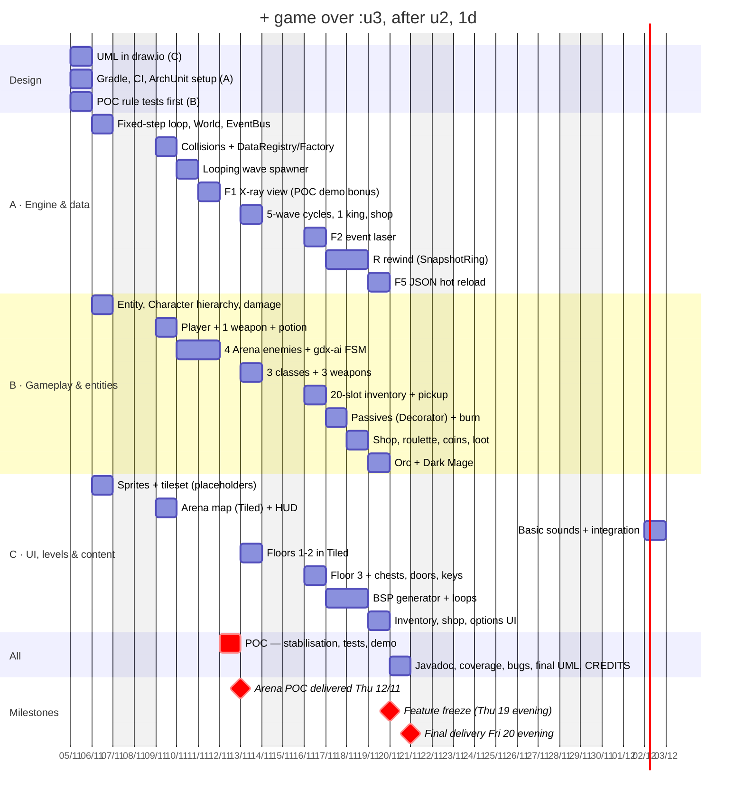

# Calendar

The 12 Nov POC was cancelled on 4 Nov. The only delivery is the full GDD plus the full playable game on 22 Nov at 23:50. Internal milestone (confirmed by Ange, 4 Nov): the GDD is finished by 5 Nov. The team fills in the rest of this tab once the GDD is done.

## Milestones

| Milestone | Date | Deliverable | Owner | Status |
| --- | --- | --- | --- | --- |
| Full GDD | Nov 5, 2026 | GDD |  |  |
| POC | Nov 12, 2026 | Cancelled on 4 Nov, no intermediate delivery. Its scope stays as the first slice to build and the Arena game mode (GDD 1.1.1). |  | Not started |
| Full GDD + full game | Nov 22, 2026, 23:50 | Full playable game, all GDD sections filled, UML, unit tests + CI, coverage, Javadoc | All | In progress |
| Review presentation | To set | Present game and documents, playable demo | All | Not started |
|  |  |  |  |  |

## Week by week (to fill after the GDD)

| projet programation orienté objetWeek | Ange | Loïc | Romain |
| --- | --- | --- | --- |
| 3–9 Nov |  |  |  |
| 10–16 Nov&#32; |  |  |  |
| 17–22 Nov (full GDD + game on 22 Nov, 23:50) |  |  |  |

## Proposed schedule (Loïc's Claude, 5 Nov) \[OPEN\]

Loïc's day-by-day plan, for the team to validate. Two points conflict with earlier decisions, so the Milestones table above is left unchanged until the team decides: (1) this plan delivers an Arena POC on Thu 12 Nov, but the 12 Nov POC was cancelled on 4 Nov (Agent channel); (2) the "Cut scope" list reverses decisions of 4 Nov (all four engine features ship, TAB editor included; three kings; Alchemist and Necromancer in the roster; key remap in Options). Internal final delivery: Fri 20 Nov evening; the official deadline stays 22 Nov at 23:50. No weekend work: 12 working days.

### Work streams

- **A · Engine & data**: game loop, collisions, JSON data, debug features (F1, F2, R, F5)
- **B · Gameplay & entities**: characters, enemies, weapons, items, shop
- **C · UI, levels & content**: screens, HUD, Tiled maps, generator, sounds

### Tasks

| Day | Stream | Task | Status |
| --- | --- | --- | --- |
| Thu 5 Nov | A | Gradle, CI and ArchUnit setup | Done |
| Thu 5 Nov | B | POC rule tests, written before the code | Tests written on test/poc-rules (red until the team codes the classes) |
| Thu 5 Nov | C | UML in draw.io | Done |
| Fri 6 Nov | A | Fixed-step loop, World, EventBus | In progress: fixed-step loop done; World, EventBus, EventListener, GameEvent, DamageDealt and EntityDied built and green on `feature/world-event-bus` (Romain, taken over from Ange), not merged yet |
| Fri 6 Nov | B | Entity / Character hierarchy, damage formula | Done |
| Fri 6 Nov | C | Sprites + tileset (placeholders) | Done |
| Mon 9 Nov | B | Character extends Entity: body box in the constructor, `onUpdate()` replaces `update()`, 3 new tests in CharacterTest (Romain, merged on main) | Done |
| Mon 9 Nov | A | AABB collisions + JSON DataRegistry / EntityFactory | To do |
| Mon 9 Nov | B | Player + 1 weapon + potion | To do |
| Mon 9 Nov | C | Arena map (Tiled) + HUD | To do |
| Mon 9 Nov | B | Entity implements Updatable + Collidable: `blocks()`, `onContact()`, `position()`, `moveTo()`, 12 tests in EntityTest (Loïc, PR #21) | Done |
| Tue 10 Nov | A | Looping enemy waves | To do |
| Tue 10 → Wed 11 Nov | B | 4 Arena enemies + gdx-ai FSM | To do |
| Tue 10 Nov | C | Title screen + game over | To do |
| Wed 11 Nov | A | F1 X-ray view (demo bonus) | To do |
| Wed 11 Nov | C | Basic sounds + integration | To do |
| Thu 12 Nov | All | **Arena POC: stabilisation, green tests, demo, delivery** | To do |
| Fri 13 Nov | A | 5-wave cycles, 1 king, shop | To do |
| Fri 13 Nov | B | 3 classes + 3 weapons | To do |
| Fri 13 Nov | C | Floors 1–2 in Tiled | To do |
| Mon 16 Nov | A | F2 event laser | To do |
| Mon 16 Nov | B | 20-slot inventory + pickup | To do |
| Mon 16 Nov | C | Floor 3 + chests, doors, keys | To do |
| Tue 17 → Wed 18 Nov | A | R rewind (SnapshotRing) | To do |
| Tue 17 Nov | B | Passive items (Decorator) + burn | To do |
| Tue 17 → Wed 18 Nov | C | BSP generator + loops | To do |
| Wed 18 Nov | B | Shop, roulette, coins, loot | To do |
| Thu 19 Nov | A | F5 JSON hot reload | To do |
| Thu 19 Nov | B | Orc + Dark Mage | To do |
| Thu 19 Nov | C | Inventory, shop and options UI | To do |
| Fri 20 Nov | All | **Javadoc, 70 % coverage, bugs, final UML, CREDITS, rehearsal, delivery** | To do |

### Rotation (Loïc's Claude, 6 Nov) \[OPEN\]

Proposal for the team to confirm: everyone does a bit of everything, so each person changes stream every day. Over the 9 days with three tasks, each person gets every stream exactly 3 times. The tasks are the ones in the table above.

| Day | Ange | Loïc | Romain |
| --- | --- | --- | --- |
| Fri 6 Nov | A · Fixed-step loop, World, EventBus | B · Entity / Character hierarchy, damage formula | C · Sprites + tileset (placeholders) |
| Mon 9 Nov | B · Player + 1 weapon + potion | C · Arena map (Tiled) + HUD (not started; did B · Updatable + Collidable on Entity instead, PR #21) | A · AABB collisions + JSON DataRegistry / EntityFactory |
| Tue 10 Nov | C · Title screen + game over | A · Looping enemy waves | B · 4 Arena enemies + gdx-ai FSM (day 1 of 2) |
| Wed 11 Nov | A · F1 X-ray view | C · Basic sounds + integration | B · 4 Arena enemies + gdx-ai FSM (day 2 of 2) |
| Thu 12 Nov | All | All | All |
| Fri 13 Nov | C · Floors 1–2 in Tiled | B · 3 classes + 3 weapons | A · 5-wave cycles, 1 king, shop |
| Mon 16 Nov | A · F2 event laser | C · Floor 3 + chests, doors, keys | B · 20-slot inventory + pickup |
| Tue 17 Nov | B · Passive items (Decorator) + burn | A · R rewind (day 1 of 2) | C · BSP generator + loops (day 1 of 2) |
| Wed 18 Nov | B · Shop, roulette, coins, loot | A · R rewind (day 2 of 2) | C · BSP generator + loops (day 2 of 2) |
| Thu 19 Nov | C · Inventory, shop and options UI | B · Orc + Dark Mage | A · F5 JSON hot reload |
| Fri 20 Nov | All | All | All |

Rules:

- A two-day task stays with the same person until it is done.
- Each day's task ends as a pull request ready for review, so the next person starts from `main`.
- Swaps are fine: two people trade a day and note it here.
- Mon 9 Nov: Romain took over World and EventBus from Ange and fixed Character, so the Mon 9 Nov task in the Romain column, A · AABB collisions + JSON DataRegistry / EntityFactory, is still to do.
- ItemPickedUp and RoomCleared wait for Player, Enemy and Item; proposed to add them with the Mon 16 Nov tasks. \[OPEN\]
- Thu 12 keeps the "All" day of the table above. The 12 Nov POC conflict noted at the top of this section is still open.

### Milestones

- **Thu 12 Nov**: Arena POC delivered (POC frozen on Wed 11 Nov evening)
- **Thu 19 Nov evening**: feature freeze
- **Fri 20 Nov evening**: final delivery

### Gantt

### Cut scope (to validate as a team)

- TAB editor: only F5 (JSON reload) stays
- 2 of the 3 kings and boss phases: a single king with a simple attack
- Alchemist, Necromancer and poison: burn is enough to show the Decorator
- Key remapping: Options keep aim mode and FR / EN
- Music and secondary sounds: only the POC's basic sounds

If we fall behind, cut the BSP generator first (loop over the 3 Tiled floors), then Orc + Dark Mage, then F2.
